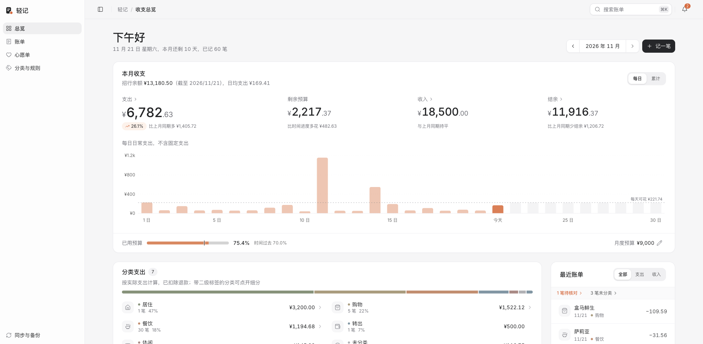
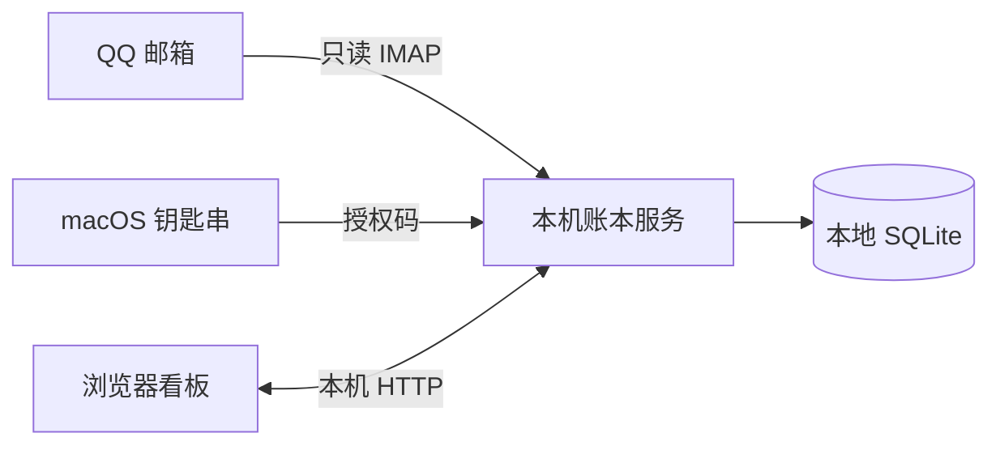

<div align="center">
  
  <h1>LedgerDesk</h1>
  <p><strong>轻记 · macOS 本地优先的个人账本</strong></p>
  <p>
    <a href="https://github.com/0xb3i/ledgerdesk/actions/workflows/ci.yml"></a>
    
    
  </p>
</div>

LedgerDesk 是一款运行在个人 Mac 上的账本应用。它从 QQ 邮箱只读同步招商银行交易提醒，将账单保存在本地 SQLite，并提供月度总览、分类、预算、交易核对、订阅提醒、心愿单与备份。



*界面截图使用隔离开发环境中的合成账单。*

## 产品特点

- **数据留在本机**：服务仅监听本机地址。账本和邮箱配置保存在本地应用数据目录，邮箱授权码保存在 macOS 钥匙串。
- **只读邮件同步**：通过 IMAP `EXAMINE INBOX` 读取 QQ 邮箱，不改变邮件已读状态；电脑离线期间收到的邮件会在恢复联网后补齐。
- **完整记录收支**：支持收入、支出、退款和转账，金额以整数分存储，并可按分类与标签查看。
- **可追溯的分类规则**：保存规则前可预览其对历史账单的影响，手动分类不会被规则覆盖。
- **本地备份与恢复**：账本可以导出并恢复。建议将备份另存到其他存储位置。

## 数据流



## 安装

需要 macOS，以及 Node.js 24 或 26 及以上版本。在项目目录运行：

```sh
npm ci
npm test
npm run test:shortcut
npm run install:local
```

安装器会构建应用、安装“轻记”启动器和用户级后台服务。之后可从 `~/Applications/轻记.app` 打开看板。应用与账本数据分开存放，更新时保留已有数据。

## 开发

```sh
npm ci
npm run dev:server          # 隔离数据目录 work/dev-data，后端端口 43928
npm run dev                 # 前端开发服务器，端口 5173
node scripts/dev-seed.mjs   # 可选：写入合成的走查数据
```

常用验证命令：

```sh
npm run check
npm test
npm run test:shortcut
npm run build:local
node scripts/install-local.mjs --dry-run
```

本地服务配置、数据目录与故障排查见[运维说明](docs/OPERATIONS.md)。接口定义见[API 文档](docs/API.md)，模块边界见[架构说明](docs/ARCHITECTURE.md)。
