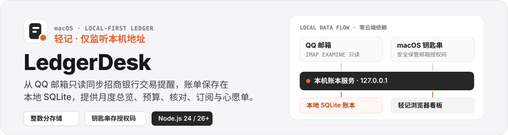

<p align="center">
  
</p>

<p align="center">
  <a href="https://github.com/0xb3i/ledgerdesk/actions/workflows/ci.yml"></a>
  
  
</p>

<p align="center">
  <a href="#月度总览">月度总览</a>&nbsp;&nbsp;·&nbsp;&nbsp;
  <a href="#产品特点">产品特点</a>&nbsp;&nbsp;·&nbsp;&nbsp;
  <a href="#安装">安装</a>&nbsp;&nbsp;·&nbsp;&nbsp;
  <a href="#开发与文档">开发与文档</a>
</p>

## 月度总览

<p align="center">
  
</p>
<p align="center"><sub>界面截图使用隔离开发环境中的合成账单。</sub></p>

## 产品特点

- **数据留在本机**：服务仅监听本机地址；账本和邮箱配置保存在本地应用数据目录，邮箱授权码保存在 macOS 钥匙串。
- **只读邮件同步**：通过 IMAP `EXAMINE INBOX` 读取 QQ 邮箱，不改变邮件已读状态；离线期间收到的邮件会在恢复联网后补齐。
- **完整记录收支**：支持收入、支出、退款和转账，金额以整数分存储，支持分类、标签、预算、交易核对、订阅提醒与心愿单。
- **可追溯分类规则**：保存规则前可预览其对历史账单的影响，手动分类不会被规则覆盖。
- **本地备份与恢复**：账本支持导出与恢复，更新应用时保留已有数据。

## 安装

需要 macOS，以及 Node.js 24 或 26 及以上版本。在项目目录运行：

```sh
npm ci
npm test
npm run test:shortcut
npm run install:local
```

安装器会构建应用、安装“轻记”启动器和用户级后台服务，之后可从 `~/Applications/轻记.app` 打开看板。

## 开发与文档

```sh
npm ci
npm run dev:server          # 隔离数据目录 work/dev-data，后端端口 43928
npm run dev                 # 前端开发服务器，端口 5173
node scripts/dev-seed.mjs   # 可选：写入合成的走查数据
```

<details>
<summary>常用验证命令与文档索引</summary>

```sh
npm run check
npm test
npm run test:shortcut
npm run build:local
node scripts/install-local.mjs --dry-run
```

- [运维说明](docs/OPERATIONS.md)：本地服务配置、数据目录与故障排查
- [API 文档](docs/API.md)：接口定义
- [架构说明](docs/ARCHITECTURE.md)：模块边界

</details>
